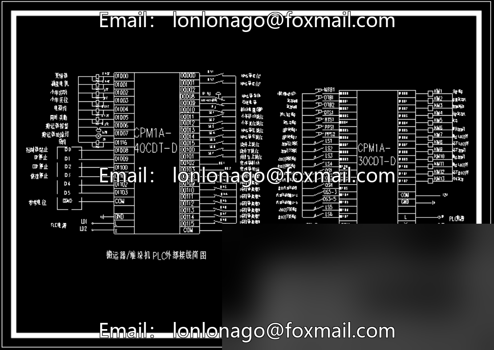
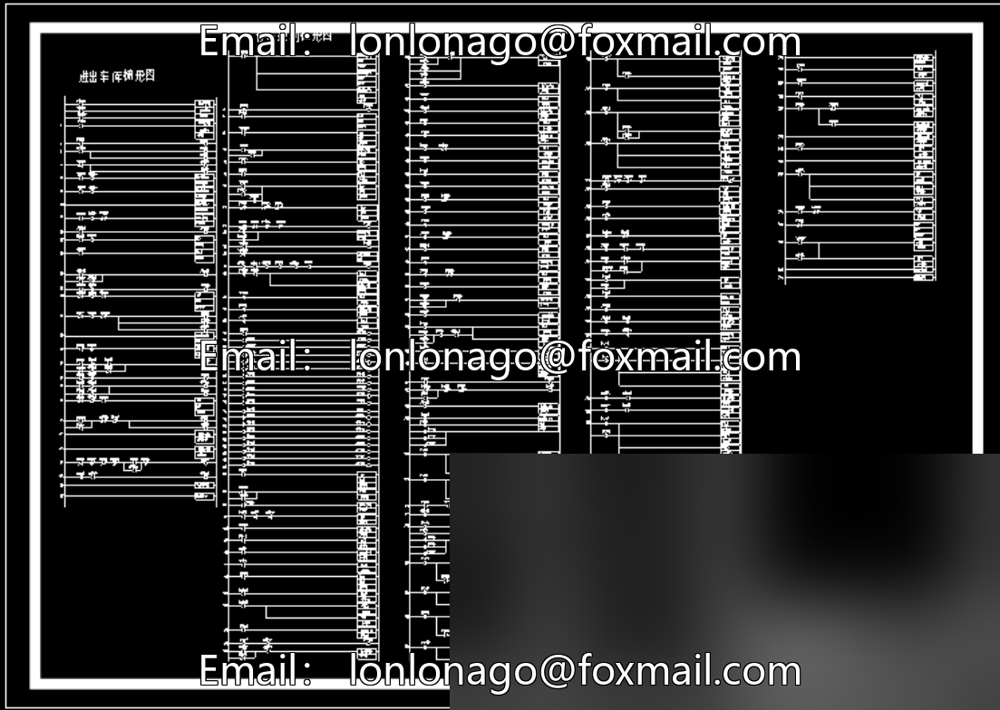
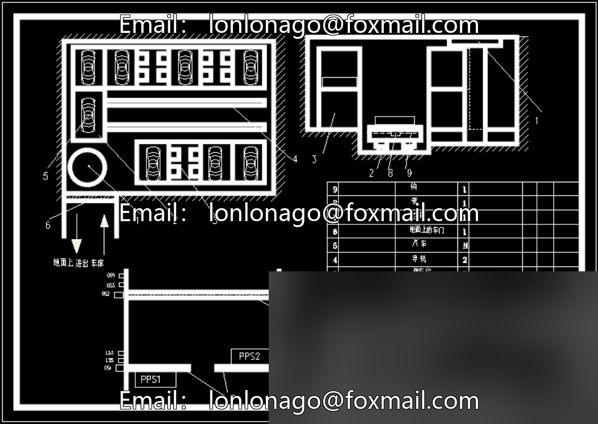

# PLC three-dimensional garage design drawing

## Body

PLC Stereo Garage Design Chart 459: Design of the PLC Stereo Garage Control System; Design Chart of the PLC Stereo Garage Control System; CAD Chart of the PLC Stereo Garage Control System; Design of the PLC Stereo Garage Control System
This document only contains reference articles and another set of reference CAD + instructions.

The document provides PLC-based solar parking design, covering transverse chain transmission, fall prevention devices, parking control system, statistics, page counts, structural details and operating principles.

<!-- AI_ENRICHED -->

## Images

## Payment

Here is a pay link on Stripe ( https://buy.stripe.com/3cs8yP7sY87d0vu9AB ). Please contact me lonlonago@foxmail.com after funding $89, and I will send you a complete data files , thank you!

